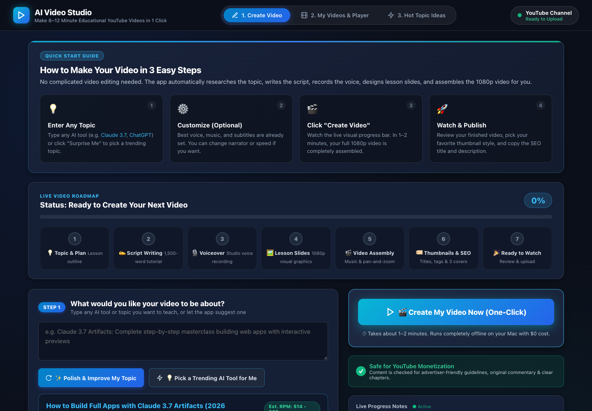
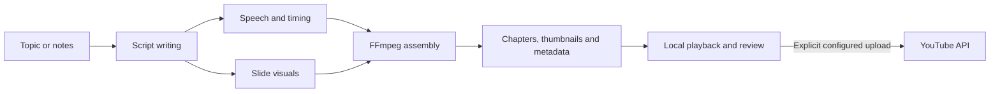

# AI Video Studio

A macOS-oriented video workspace for turning a topic into a narrated slide video, thumbnail options, captions, and upload metadata.


<details>
<summary>Mobile preview</summary>


Captured at 390×844 during the documentation review; see the verification record for observed limitations.

</details>

[Quick start](#quick-start) · [Workflow](#how-it-works) · [Project map](#project-map) · [Verification](docs/VERIFICATION.md) · [Current UI preview](docs/media/walkthrough.mp4) · [Existing 45-second demo](assets/demo.mp4)

## What this project does

The desktop dashboard coordinates Python stages for topic selection, script writing, speech, slides, video assembly, and metadata. You can browse existing projects and play their media locally. Optional cloud providers and YouTube OAuth support additional workflows.

The default path includes procedural scripts and local fallbacks; not every output comes from a live AI model. The “trending” suggestions can come from bundled examples, and the policy checker uses application heuristics rather than an official YouTube certification.

## What is verified

- The local dashboard and its status/project APIs responded.
- The existing **14 diagnostic tests passed**, including local macOS speech and graphic-generation checks.
- `assets/demo.mp4` is an existing **45.1-second, 1920×1080 H.264/AAC** recording.
- `videos/20261011_144800_final.mp4` is an existing **602.9-second, 1920×1080 H.264/AAC** example. These are historical media, not a newly generated end-to-end production run.

The browser’s upload action currently calls `/api/youtube/upload`, which is **not implemented in `desktop_server.py`**. Use the CLI upload path only after configuring and reviewing it. No video was uploaded during documentation verification.

## Quick start

For the local dashboard you need Git and Python 3. Video production is designed for macOS and uses **FFmpeg**, plus the system `say`, `afconvert`, and `sips` tools for local media generation. Verification used Python **3.14.8** on macOS.

```bash
git clone https://github.com/Skp693/YouTube-agy.git
cd YouTube-agy
python3 desktop_server.py 8501
```

Open **http://127.0.0.1:8501**. Stop the server with **Ctrl+C**. The dashboard’s core server uses the Python standard library; optional provider integrations need additional packages.

On macOS you can also run `bash run_desktop.sh`, or use `launch_app.command` from Finder. These launchers use an existing `.venv` if present; they do not install FFmpeg or all Python dependencies for you.

### Optional Python environment

```bash
python3 -m venv .venv
source .venv/bin/activate
python -m pip install -r requirements.txt
```

The requirements file includes optional cloud SDKs and the alternative class-based pipeline’s dependencies. Install FFmpeg separately and confirm `ffmpeg -version` works before producing video.

## Create a video for review

```bash
python3 main_pipeline.py --review --tool "Your chosen topic"
```

Review mode builds local artifacts and stops before live uploading. It can still call configured cloud generation providers. To keep an offline run offline, leave provider credentials unset and use the local path. Runtime and quality depend on the selected voice, tools, and output settings.

Inspect the MP4 with a media player and `ffprobe` before publishing. Assembly failures can produce a placeholder MP4 marker; a reported output path alone does not prove a playable finished video.

## How it works



The dashboard launches `main_pipeline.py` in a worker thread. `main.py` and `src/stages/` implement a separate class-based pipeline; they are not the dashboard’s execution path.

## Configuration

`config/settings.py` reads environment variables and optionally loads `.env` when `python-dotenv` is installed. Keep provider credentials and OAuth files out of Git.

| Setting | Purpose |
| --- | --- |
| `GEMINI_API_KEY`, `GEMINI_MODEL` | Optional Gemini research/script generation. |
| `GOOGLE_APPLICATION_CREDENTIALS` | Optional Google speech setup. |
| `ELEVENLABS_API_KEY`, `ELEVENLABS_VOICE_ID` | Optional ElevenLabs voice path. |
| `VIDEO_RESOLUTION_WIDTH`, `VIDEO_RESOLUTION_HEIGHT`, `VIDEO_FPS` | Output dimensions and frame rate. |
| `WORDS_PER_MINUTE`, `MIN_WORDS`, `MAX_WORDS` | Script/voice pacing settings. |
| `YOUTUBE_CLIENT_SECRETS_FILE`, `YOUTUBE_TOKEN_FILE` | OAuth file paths, defaulting under `config/`. |
| `YOUTUBE_DEFAULT_PRIVACY` | Default upload privacy, normally `private`. |

Some dashboard controls are passed into the pipeline while others are presentation options. Check their handling in `desktop_server.py` and `main_pipeline.py` before relying on a setting.

## Optional YouTube upload

Enable YouTube Data API access in your own Google Cloud project, install the Google API/OAuth packages, and place your OAuth client configuration at `config/client_secrets.json` or the configured path.

Validate an existing example without uploading:

```bash
python3 youtube_uploader.py --project-id 20261011_144800 --dry-run
```

**Dry-run does not authenticate**: it returns before OAuth and emits a simulated `DRY_RUN_...` identifier. After reviewing the actual video, use the CLI without `--dry-run` only when you intend a real upload; `--privacy private` limits its initial visibility. The live path starts OAuth if required.

The current upload request sets privacy and audience fields and adds a description notice. It does not set YouTube’s dedicated synthetic-media status field. Review the platform’s current disclosure requirements yourself; a local compliance score is not proof of platform approval or monetisation eligibility.

## Project map

| Path | What it does |
| --- | --- |
| `desktop_server.py` | Local HTTP dashboard, API routes, worker jobs, and byte-range media serving. |
| `static/` | Dashboard HTML, styling, browser state, and API requests. |
| `main_pipeline.py` | Dashboard/CLI production orchestrator and optional schedule loop. |
| `topic_selector.py`, `topic_refiner.py` | Topic selection and outline preparation, including built-in suggestions. |
| `script_writer.py` | Cloud-assisted or procedural scripts. |
| `voiceover.py` | Voice synthesis, fallback audio, concatenation, and timing. |
| `visuals.py`, `src/utils/bitmap_font.py` | Slide graphics and text rendering. |
| `assemble_video.py` | FFmpeg assembly, captions, music, and fallback output. |
| `metadata.py` | Titles, chapters, descriptions, and thumbnail variants. |
| `youtube_uploader.py` | CLI validation, OAuth, resumable upload, and thumbnail setting. |
| `compliance_checker.py`, `model_advisor.py` | Heuristic content checks and environment/provider suggestions. |
| `config/` | Settings, logging setup, and optional private OAuth files. |
| `src/stages/`, `src/models.py`, `main.py` | Separate class-based pipeline and state models. |
| `src/utils/browser_recorder.py` | Optional website B-roll capture helper. |
| `topics/`, `scripts/`, `audio/`, `images/`, `videos/`, `thumbnails/`, `metadata/` | Generated project artifacts. In this repo, `scripts/` contains output scripts/captions, not just utility code. |
| `assets/`, `test_results_20261012/` | Historical demo media and test artifacts. |
| `tests/test_pipeline_diagnostic.py` | Existing local diagnostic tests. |

[Complete tracked-file inventory](docs/FILE_GUIDE.md).

## Checks and troubleshooting

```bash
python3 -m unittest discover -s tests -v
ffprobe -v error -show_format -show_streams videos/20261011_144800_final.mp4
```

Tests create local files. Use a checkout where generated artifacts are safe to change.

- **No speech or invalid MP4:** inspect provider errors and the macOS/FFmpeg tool paths; fallbacks can hide a failed production stage.
- **Upload button fails:** the dashboard route is missing; use the reviewed CLI path.
- **State disappears after restart:** active job tracking is in memory; generated files remain on disk.

See [verification details](docs/VERIFICATION.md) for the tested revision and limits.

## Contributing, support, and license

Open [issues](https://github.com/Skp693/YouTube-agy/issues) with a project ID, command, and redacted error. Never attach OAuth tokens. The previous README claimed MIT, but the reviewed snapshot has no license file; contact the owner to establish reuse terms.
