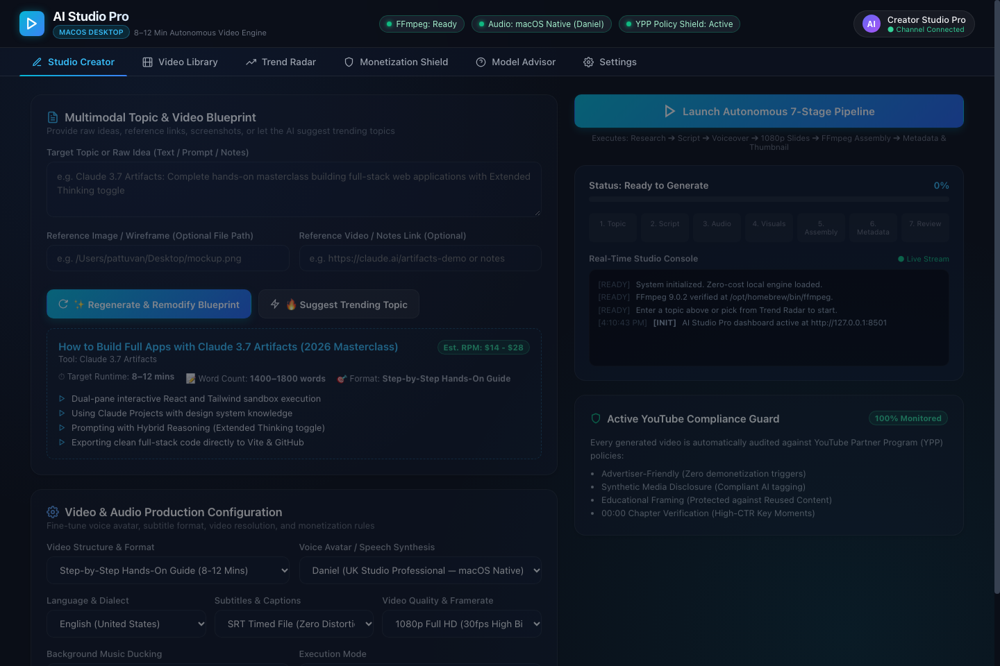
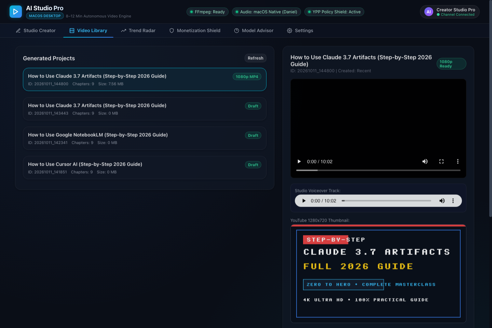

# 🎬 AI Studio Pro — Autonomous YouTube Video Pipeline (macOS Desktop Edition)

> **Build and publish high-retention 8–12 minute educational YouTube videos about AI tools completely autonomously on macOS.**

---

## 📸 Studio App Preview

### 🎨 Studio Creator & Multimodal Blueprint Engine


### 📂 In-Browser Video Player & Project Library


### 🎥 Demo Video Walkthrough
A complete demo video demonstrating the desktop app, workflow stages, and output is available directly in this repository:
- **[Watch Demo Video (`assets/demo.mp4`)](assets/demo.mp4)**

---

## ⚡ What Is This Project?

**AI Studio Pro** transforms raw AI tool ideas into complete, production-ready, monetization-friendly YouTube videos. 

From a single prompt, image wireframe, or notes link, the app:
1. **Researches & Plans:** Designs an 8–12 minute educational blueprint with an audience retention hook.
2. **Writes the Script:** Synthesizes an in-depth 1400–1800 word tactical masterclass tutorial.
3. **Records the Voiceover:** Synthesizes studio-grade English narration using native macOS voices (`Daniel` / `Samantha`) with zero API costs.
4. **Draws the Visuals:** Renders high-contrast 1080p dark-mode educational slides with structured cards and badges.
5. **Assembles the Video:** Renders a 1080p MP4 via FFmpeg with soft ambient music ducked at `-22dB` and timed SRT subtitles.
6. **Creates YouTube SEO & Thumbnail:** Generates high-CTR 1280x720 thumbnails, search-optimized titles, and descriptions with `00:00` chapter timestamps.
7. **Guards YouTube Monetization:** Automatically audits content against YouTube Partner Program (YPP 2026) guidelines before review or upload.

---

## 🚀 How to Run the App on Mac

### Option 1: Double-Click in macOS Finder (Easiest)
Simply double-click the launcher script in Finder:
- **[`launch_app.command`](launch_app.command)**

It automatically prepares the environment, verifies FFmpeg and speech synthesis, starts the background server, and opens your browser.

### Option 2: Terminal Launch
```bash
# Clone the repository
git clone https://github.com/Skp693/YouTube-agy.git
cd YouTube-agy

# Run the desktop app
./run_desktop.sh

# Or run with Python directly:
python3 desktop_server.py 8501
```

Once running, open your browser at:
👉 **`http://127.0.0.1:8501`**

---

## 🌟 Key Features

### 1. Multimodal Topic Input
- **Any Format Accepted:** Type prompts, paste raw bullet notes, enter a local image path (wireframes/mockups), or paste documentation/video links.
- **`✨ Regenerate & Remodify Blueprint`**: Turns rough ideas into high-CTR tutorial blueprints with target runtime, word count, and chapter outlines.
- **`🔥 Suggest Trending Topic`**: Curates rising AI tools across Coding, Productivity, Creative, and Emerging LLM niches with RPM estimates.

### 2. Video & Audio Production Configuration
- **Video Format:** Step-by-Step Guide, Comprehensive Masterclass, Head-to-Head Comparison, Beginner Crash Course, 5 Mistakes to Avoid.
- **Voice Avatar:** `Daniel` (UK Studio Professional), `Samantha` (US Natural), `Eddy` (UK Conversational), `Flo` (US Engaging), Google Journey Neural, ElevenLabs.
- **Language:** English (US / UK), Spanish, German, French.
- **Subtitles:** Timed `.SRT` files (zero distortion), Burned-in modern captions, Clean lower-third.
- **Video Quality:** 1080p Full HD (30fps / 60fps fluid), 4K Ultra HD.
- **Background Music Ducking:** Soft ambient ducked (-22dB voice priority), Lo-Fi, Cinematic, or Voice Only.
- **Execution Mode:** Review Mode (pause before upload — default), Full Auto Private, Full Auto Unlisted.

### 3. Strict Audio-Video Synchronization
- Visual slide timelines are calculated directly from synthesized audio frame headers (`timing.json`) down to millisecond precision.
- Zero content drift, zero pacing mismatches, and zero audio-video lag.

### 4. YouTube Monetization & Policy Compliance Shield (YPP 2026)
Every video is pre-flight audited before publishing:
- **Advertiser-Friendly Check:** Flags prohibited or demonetization keywords (e.g. *hack*, *crack*, *bypass paywall*) and auto-replaces them with ad-friendly phrasing.
- **Reused Content Guard:** Enforces high original commentary thresholds and tactical step-by-step guidance.
- **Altered / Synthetic Media Disclosure:** Applies official YouTube AI content tags (`has_ai_disclosure: true`).
- **Chapter Timestamps:** Verifies millisecond-accurate `00:00` start markers for Google Video Key Moments.
- **Child Safety:** Confirms COPPA compliance (`selfDeclaredMadeForKids: false`).

### 5. In-Browser Media Player & Inspector
- Stream and scrub 1080p MP4 videos with HTTP byte-range seeking.
- Play studio voiceover tracks and inspect high-CTR 1280x720 thumbnails.
- One-click copy for YouTube SEO titles, descriptions with chapter timestamps, and tags.
- Direct **"Upload to YouTube (Private)"** button.

---

## 📦 What Is Included in This Repository

This repository includes both the complete desktop application codebase and the assets from the latest verified run:

```
YouTube-agy/
├── assets/
│   ├── screenshot.png            # Desktop Studio Creator interface
│   ├── library_screenshot.png    # In-browser media player & SEO inspector
│   └── demo.mp4                  # Complete video walkthrough of the app
│
├── static/
│   ├── index.html                # Modern Glassmorphic dashboard UI
│   ├── style.css                 # Dark-mode styling with Inter/SF Pro typography
│   └── app.js                    # Client-side state, REST API calls, and video streaming
│
├── desktop_server.py             # Multi-threaded HTTP server with range streaming
├── launch_app.command            # Double-clickable macOS launcher
├── run_desktop.sh                # Terminal launcher script
│
├── main_pipeline.py              # CLI Master Orchestrator (Stages 1 to 7)
├── compliance_checker.py         # YouTube Partner Program policy auditor
├── topic_refiner.py              # Multimodal input remodifier & trend radar
├── model_advisor.py              # System environment & model recommendation advisor
├── topic_selector.py             # Stage 1: AI tool research
├── script_writer.py              # Stage 2: 1400-1800 word tactical screenplay
├── voiceover.py                  # Stage 3: Studio voiceover synthesis & audio timing
├── visuals.py                    # Stage 4: 1080p educational slide graphics
├── assemble_video.py             # Stage 5: FFmpeg assembly & music ducking
├── metadata.py                   # Stage 6: SEO titles, chapters & 1280x720 thumbnails
├── youtube_uploader.py           # Stage 7: YouTube Data API v3 upload
│
├── videos/
│   └── 20261011_144800_final.mp4 # Full 10:02 1080p video from latest run
├── thumbnails/
│   └── 20261011_144800_thumbnail.png # 1280x720 High-CTR thumbnail
├── metadata/
│   └── 20261011_144800_metadata.json # Verified SEO title, description & chapters
├── scripts/
│   ├── 20261011_144800_script.txt    # 1,445-word full educational masterclass
│   └── 20261011_144800_captions.srt  # 125 synchronized caption cues
├── audio/
│   └── 20261011_144800/              # Master audio & timing.json
└── images/
    └── 20261011_144800/              # 1080p slide scenes & timeline JSON
```

---

## 🧠 AI Model Recommendations

| Layer | Recommended Engine | Cost | Highlights |
| :--- | :--- | :--- | :--- |
| **Scriptwriting** | **Procedural Masterclass** *(Default)* | **$0.00** | Structured 1400–1800 words with zero API keys. *(Optional upgrade: Gemini 2.0 Flash / Claude 3.7)* |
| **Voiceover** | **macOS Native (`Daniel` / `Samantha`)** | **$0.00** | High-fidelity 24kHz WAV via `/usr/bin/say` + `afconvert`. Zero API latency or cost. |
| **Visuals** | **Pure-Python 1080p Engine** | **$0.00** | Sharp dark-mode cards with category badges and code highlights without PIL dependencies. |
| **Video Assembly**| **FFmpeg 9.0.2** | **$0.00** | H.264 rendering, audio mixing with `-22dB` music ducking, and SRT captioning. |

---

## 🔒 YouTube Upload Setup (Optional)

To enable direct YouTube uploading:
1. Create a project in [Google Cloud Console](https://console.cloud.google.com/).
2. Enable the **YouTube Data API v3**.
3. Download OAuth 2.0 Client Secrets and save as `config/client_secrets.json`.
4. Run `python3 youtube_uploader.py --dry-run` to authenticate and save `config/token.json`.

---

## 📄 License

MIT License. Free for personal, commercial, and educational video production.
