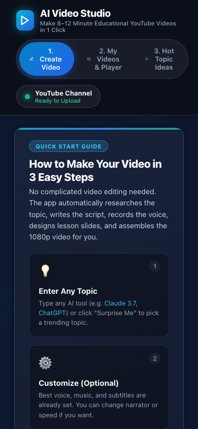

# Verification record

Reviewed on **28 October 2026, Asia/Dubai** against default-branch commit [`db87567ac4698e7f229ff4d09ee24c83d8f3a143`](https://github.com/Skp693/YouTube-agy/tree/db87567ac4698e7f229ff4d09ee24c83d8f3a143).

## Scope and environment

The tracked-file inventory contains **107 entries**: 68 text, 39 binary. Application entry points, package scripts, configuration, storage behavior, API contracts, existing README claims, and major UI components were reviewed to write the documentation. Binary assets were inventoried; key screenshots and videos were inspected where used. Inherited app-builder material and generated artifacts are identified separately in the file guide.

Local tools: macOS, Node 26.10.0, Bun 1.4.2, Python 3.14.8. These are the observed versions, not an inferred minimum compatibility promise.

## Command results

python3 -m unittest discover -s tests -v: 14 tests passed.

## Runtime and deployment observations

Local dashboard, GET /api/status, and GET /api/projects responded. Existing videos were inspected with ffprobe. assets/demo.mp4: 45.067917 seconds, 1920x1080 H.264/AAC; videos/20261011_144800_final.mp4: 602.897750 seconds, 1920x1080 H.264/AAC. No new full production video was generated and no upload or provider purchase was made. The dashboard upload endpoint /api/youtube/upload is absent in the server.

No production setting, application source, user account, payment, or publishing configuration was changed as part of this documentation update. Media and documentation are the only intended repository changes.

## Visual evidence

[Desktop capture](media/desktop.png) · [Mobile capture](media/mobile.png) · [Silent interface preview](media/walkthrough.mp4)

The images and silent preview show the local interface at the reviewed source snapshot. They are real browser captures, not generated artwork. The short preview records page loading, scrolling, and a viewport resize; it is not an end-to-end AI, payment, or publishing demonstration. Desktop viewport: 1440×1000; mobile viewport: 390×844.

## Rechecking later

Use the commands in the README, confirm the source revision, and inspect both UI rendering and API responses. Deployments, provider models, credentials, and dependencies can change after this snapshot. A build or HTML response does not by itself establish a complete working user journey.
